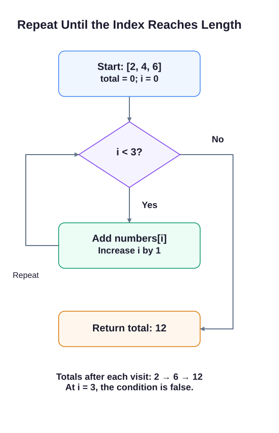

# For Loops


A loop can visit each value in a list, adding to a total or collecting a new order.

Loops let you repeat a block of code. An array such as `[2, 4, 6]` is an ordered list; you will study arrays in depth later, but here you only need to visit its values. `numbers.length` counts entries, `numbers[i]` reads one entry (starting at index 0), and `result.push(value)` adds an entry to a new array. An empty array is written `[]`. A `const` result array can still receive entries with `push`: const prevents assigning a different array to the name, not changing the contents of this one.

## Traditional `for` loop

```javascript run
for (let i = 0; i < 5; i++) {
    console.log(i); // five separate lines: 0 through 4
}
```

Iterating an array:

```javascript run
const fruits = ["apple", "banana", "cherry"];
for (let i = 0; i < fruits.length; i++) {
    console.log(fruits[i]);
}
```

## `for...of` — iterate values

Cleaner syntax when you only need the value, not the index:

```javascript
for (const fruit of fruits) {
    console.log(fruit);
}
```

The `fruits` list here is the same list from the preceding example. If you copy this block into a new script, declare `fruits` first.

For the reverse task, start at `arr.length - 1` (the last index), step backward with `i--`, and push each visited value into a new array. An empty array gives a sum of 0 because the loop runs zero times. Object-key iteration comes in the Objects module; it is not needed here.

A traditional `for` header has three parts: set up the counter once; check the condition before each pass; update the counter after each pass. `i++` adds 1 and `i--` subtracts 1. For a three-entry list, the valid indexes are 0, 1, and 2, so the forward condition uses `< length`, not `<= length`.

Keep the running total outside the loop body but inside the function. That gives each call a fresh total while allowing successive iterations to add to it. Return after the loop; returning inside it would stop at the first entry.

The starter prints lists by inserting them into template strings, which shows their values separated by commas. Brackets around the empty-list probe make an empty result visible as `[]`. It safely prints `[undefined]` while the function is unfinished. You do not need to write or change the supplied probes.

Edit `script.js`, Run to inspect the supplied probes, and Submit to check the tasks.



## Your Tasks

1. Implement `sumArray(numbers)` with a `for` loop. Return the total, including 0 for an empty list; the supplied `Sums` line should show `2,15,10,0`.
2. Implement `reverseArray(arr)` with a backward `for` loop and a new result array. The supplied `Reversals` line should show `3,2,1 | c,b,a | []`.
3. Log `Sum: 15` on its own line by calling `sumArray([1,2,3,4,5])`.
