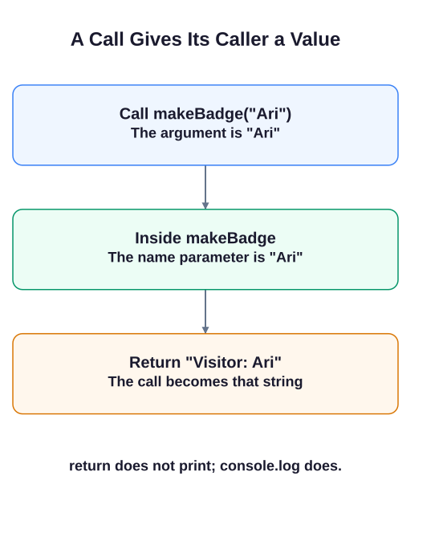

# Defining functions

The Starline Awards desk needs the same greeting for every guest. A function lets you write that rule once and supply a different name each time.

`function` starts a declaration. The name before the parentheses identifies the function; the name inside them is a **parameter**, a local name for the input. The braces contain the work to do. Defining the function does not run its body.

```javascript run
function makeBadge(name) {
  return `Visitor: ${name}`;
}
const badge = makeBadge("Ari");
console.log(badge);
console.log(makeBadge("Nia"));
```

`makeBadge("Ari")` is a **call**. `"Ari"` is its argument: the value assigned to `name` for that call. The backtick string inserts that value at `${name}`.

`return` ends the call and sends a value back. It does not print. `console.log()` prints the value it receives; without a `return`, a function's result is `undefined`. Keeping these jobs separate lets another calculation or message use the result.



Run the example and compare its two names. In the editor, the empty function is supplied. Fill its body rather than declaring a second `greet`. The supplied `try`/`catch` blocks keep an unfinished call from stopping the other probes; you do not need to edit those blocks.

## Your Tasks

1. Complete `greet(name)` so it returns `Hello, <name>!` for the supplied name.
2. Log `Hello, Alice! | Hello, Bob!` on its own line by calling `greet` twice.

Edit `script.js`, then Run after each step. The supplied probes show the values being checked; leave them in place. Submit checks the numbered tasks in order. You do not need to write extra checkpoint logs.
