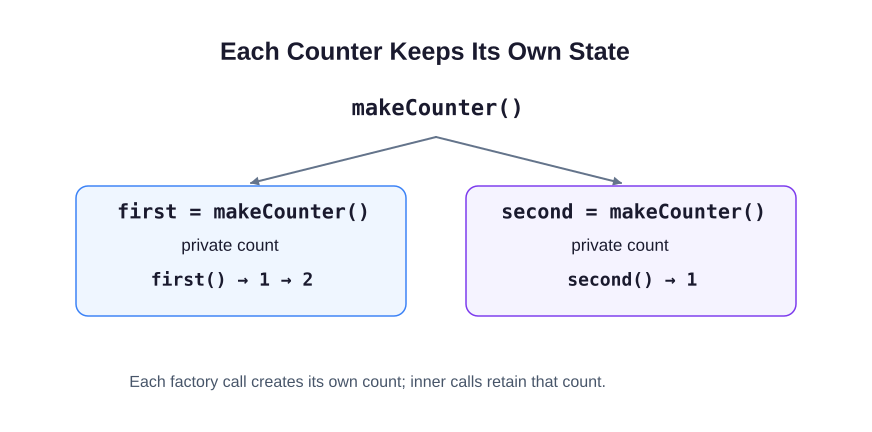

# Closures

A ticket counter must remember how many tickets it has issued. A function can return another function as its result, just as it can return a string.

In this example, `return function () { ... };` creates a function value without a name and gives that value to the caller. The **outer** function runs once when you create the dispenser. The **inner** function runs whenever you take a ticket.

```javascript run
function makeTicketDispenser() {
  let nextTicket = 10;
  return function () {
    const issued = nextTicket;
    nextTicket += 1;
    return issued;
  };
}
const takeTicket = makeTicketDispenser();
console.log(takeTicket(), takeTicket());
const otherDesk = makeTicketDispenser();
console.log(otherDesk());
```

The returned function keeps access to `nextTicket` after the outer call finishes. This connection between a function and its surrounding variables is a **closure**. Each call to the outer function creates separate state. That is why the other desk starts at 10 rather than 12.



Keep your count declaration outside the returned function. Putting it inside would reset it on every call. Your exercise starts each counter at zero and increments before returning, so its first result is 1.

## Your Tasks

1. Complete `makeCounter()` so each call creates a private count starting at zero and returns a function that increments and returns that count.
2. Create a fresh counter and log `1 | 2 | 3` by calling that same counter three times.

Edit `script.js`, then Run after each step. The supplied probes show the values being checked; leave them in place. Submit checks the numbered tasks in order. You do not need to write extra checkpoint logs.
