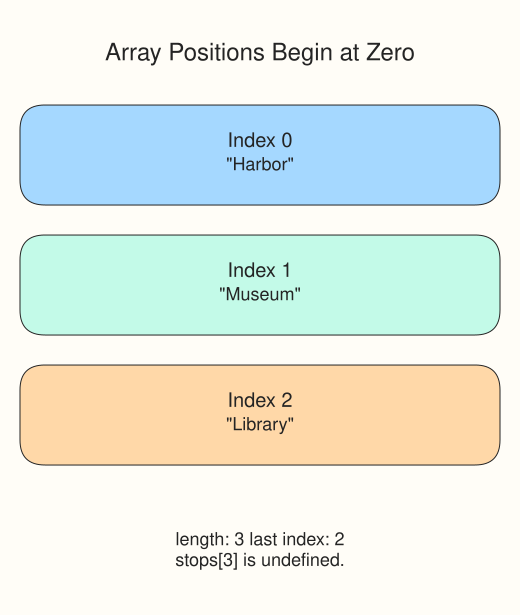

# Arrays

The Starline Awards setlist needs an ordered place to store its stops. An **array** groups values inside square brackets, separated by commas.

```javascript run
const stops = ["Harbor", "Museum", "Library"];
console.log(stops[0]);
console.log(stops.length);
console.log(stops[stops.length - 1]);
```

An **index** is a position starting at zero. Three items have indices 0, 1, and 2; `length` is the count, not the last index. Reading an absent position gives `undefined`.



You can replace an item with an assignment such as `stops[1] = "Park"`. That changes the array, a **mutation**. `const` prevents assigning a different array to `stops`; it does not freeze its items.

The supplied probe uses `JSON.stringify(colors)` to turn the array into text with brackets and quotes. You can leave that formatting code alone. Logging an array directly in this course's Console shows comma-separated values instead.

Run the stops example, then build the different color list in your editor.

## Your Tasks

1. Fill `colors` with `"red"`, `"green"`, and `"blue"` in that order.
2. Log `red | blue` using index `0` and index `colors.length - 1`.

Edit `script.js`, then Run after each step. The supplied probes show the values being checked; leave them in place. Submit checks the numbered tasks in order. You do not need to write extra checkpoint logs.
