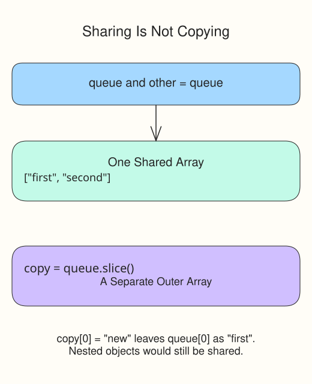

The setlist queue grows when an item arrives and shrinks when its last item is removed. `push(value)` adds at the end; `pop()` removes and returns the last value.

```javascript run
const wateringQueue = ["fern", "ivy"];
wateringQueue.push("orchid");
console.log(wateringQueue.join(","));
const lastPlant = wateringQueue.pop();
console.log(lastPlant, wateringQueue.join(","));
```

`join(",")` makes a string by placing commas between the values. It does not change the array. `push()` returns the new length, not the added item; `pop()` returns the removed item, or `undefined` for an empty array.

Both mutation methods change the existing array. If you write `const other = wateringQueue`, the two names refer to the same array: `other.push(...)` changes what both names see.

The diagram also previews `slice()`, which copies the outer array. You will use it in the next lesson.



Run the example and compare the queue before and after removal. In the editor, leave each probe after its corresponding change so it can show the intermediate state.

## Your Tasks

1. Use `queue.push("third")` to append the new item before the first probe.
2. Replace the empty string in the `removedItem` declaration with `queue.pop()`.
3. Log `first,second | third` using `queue.join(",")` and `removedItem`.

Edit `script.js`, then Run after each step. The supplied probes show the values being checked; leave them in place. Submit checks the numbered tasks in order. You do not need to write extra checkpoint logs.
