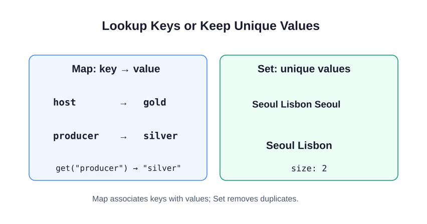

A profile object names fixed facts about one person. A `Map` is useful for a growing lookup table, such as a badge color for each role. A `Set` keeps distinct values, such as the cities on a tour. Map keys can also be numbers or objects; these examples use string keys.



`new Map(...)` creates a collection from an array of `[key, value]` pairs. The outer array holds the entries; each inner array contains one key and its value. `new Set(...)` takes a list of values and keeps duplicates only once.

```javascript run
const badgeByRole = new Map([
  ["host", "gold"],
  ["producer", "silver"]
]);
const citiesOnTour = new Set(["Seoul", "Lisbon", "Seoul"]);
console.log(badgeByRole.get("producer"));
console.log(citiesOnTour.size);
```

Run the example: `get("producer")` reads `"silver"`, while `.size` counts two distinct cities. Size is a property, so it has no parentheses. `.has(value)` on a Set reports whether the value is present.

To add data later, use `badgeByRole.set("guest", "blue")` or `citiesOnTour.add("Lima")`. Setting an existing Map key replaces its value; adding an existing Set value leaves its size unchanged. A missing Map key returns `undefined`. Both collections retain insertion order.

The next exercise changes the data to songs and artists. Notice that Map keys are unique too: a song title can have one current duration.

## Learn more

MDN's [Map](https://developer.mozilla.org/en-US/docs/Web/JavaScript/Reference/Global_Objects/Map) and [Set](https://developer.mozilla.org/en-US/docs/Web/JavaScript/Reference/Global_Objects/Set) references list the available methods.
