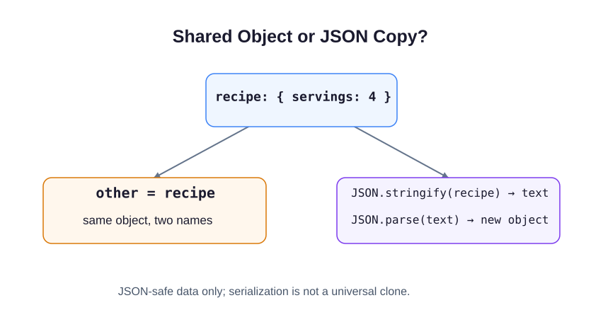

An object in a running program is not the same as a text message containing its data. JSON (JavaScript Object Notation) is a text format that lets programs exchange structured values.

JSON object keys and string values use double quotes. Values may be strings, numbers, booleans, `null`, arrays, or objects. Comments, functions, and `undefined` are not JSON values.

## Turn values into text and back

```javascript run
const recipe = { dish: "Soup", servings: 4 };
const recipeText = JSON.stringify(recipe);
console.log(recipeText);
const restoredRecipe = JSON.parse(recipeText);
console.log(restoredRecipe.servings);
```

`JSON.stringify()` produces a string. `JSON.parse()` reads a JSON string and produces the represented value, which could be an object, array, or a simpler value. Invalid JSON causes an error; the exercise supplies valid JSON, so you do not need error handling yet.

The diagram follows a smaller object with just a `servings` property.



## A separate copy

Assigning `const other = recipe` gives the same object another name. A change through either name affects that one object. Parsing serialized JSON-safe data instead creates a separate object, including separate nested objects.

This is a deliberately limited copying exercise. JSON drops object properties whose values are functions or `undefined`; a Date becomes text, and serializing a BigInt throws by default. Circular references also fail. Do not treat this helper as a universal clone function.

Edit `script.js`. The starter supplies the original nested object, calls your clone helper, and prints checks before and after your copy-only edit. Keep those checks. Run to inspect the values, then Submit.

## Your Tasks

1. Serialize the supplied `user` object into `userJson` with `JSON.stringify()`.
2. Parse the supplied `apiResponse` string into `parsed` with `JSON.parse()`.
3. Complete `deepClone(obj)` with a JSON round trip for JSON-safe data. The supplied call stores its result in `cloned`.
4. Set only `cloned.nested.b` to `99`, leaving `original.nested.b` at `2`.
5. Log `Sam is level 5 | status: ok, count: 42` on its own line using `user` and `parsed`.
