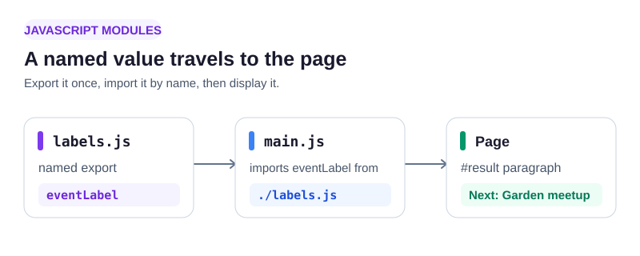

A community board needs a reusable label for its next gathering. The File Explorer shows separate files: the browser starts at `src/main.js`, which can pull values from another file.



An `export` makes a value available to other modules. An `import` names the value to bring in; `./labels.js` is relative to **main.js**, not to the HTML file. The `.js` extension makes the path explicit. Here is the pattern:

```javascript
// labels.js
export const place = "Library";
// main.js
import { place } from "./labels.js";
```

Open `src/labels.js` in the File Explorer, then `src/main.js`. Run the page after each change. The line below the heading should become **Next: Garden meetup**. If it stays at “Waiting for a label,” check both the export name and import path.

## Your Tasks

1. Export a named constant `eventLabel` with the text `Garden meetup` from `src/labels.js`.
2. Import `eventLabel` from `./labels.js` in `src/main.js` and display `Next: Garden meetup` in the `#result` paragraph.

That label can now travel between files without copying its text.

