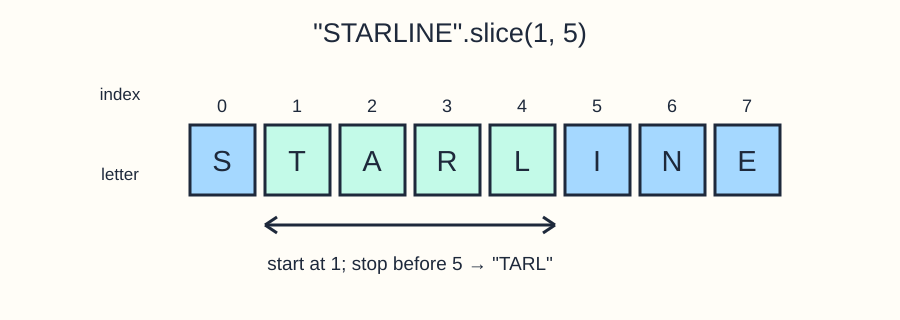

# String methods

Prepare an uppercase caption and check whether the original text contains a particular word. String methods return results without changing the original string.

```javascript run
const trailName = "river loop";
console.log(trailName.toUpperCase());
console.log(trailName.includes("loop"));
console.log(trailName);
```

`toUpperCase()` returns new text. `includes()` returns a boolean and is case-sensitive: `"river loop".includes("Loop")` is false. Store each result if you want to use it again.

## Read positions with slice



Positions start at `0`. `slice(start, end)` includes the position at `start` and stops before `end`. `"STARLINE".slice(1, 5)` returns `"TARL"`; the original string is unchanged. Indexing, such as `text[0]`, reads one position. These examples use ordinary Latin letters; some emoji and other Unicode characters occupy more than one JavaScript string position.

Edit `script.js`. Replace the placeholder values but keep the two supplied checks. Run to inspect both results, then Submit.

## Your Tasks

1. Set `upperPhrase` from `phrase` with `toUpperCase()`.
2. Set `hasWorld` from `phrase` with `includes("world")`.
3. Log `HELLO WORLD | true` on a separate line using the computed values.
