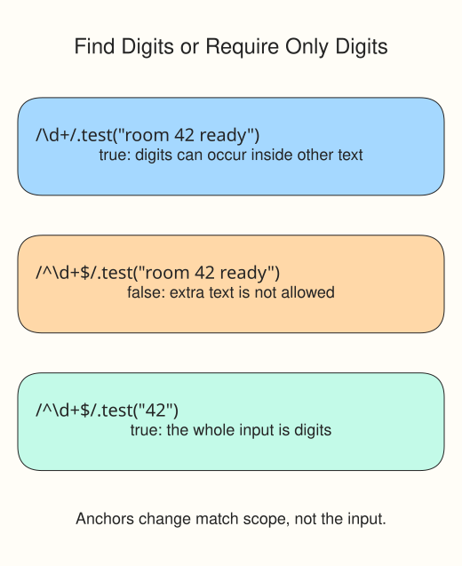

A regular expression, or regex, describes a text pattern. Use one when a substring search is too loose, such as checking the shape of an email-like address or finding digit sequences inside a sentence.

## Read the pattern before using it

A regex literal goes between slashes: `/hello/i`. The slashes mark the pattern's boundaries; they are not part of the text to match. The optional `i` flag ignores letter case. Without it, `/hello/` does not match `"HELLO"`.

| Syntax | Meaning in these examples |
| --- | --- |
| `\d` | One digit from 0 to 9 |
| `\s` | One whitespace character |
| `[abc]` | One character from the listed choices |
| `[^abc]` | One character not among those choices |
| `+` | One or more of the preceding item |
| `{5}` | Exactly five of the preceding item |
| `^` and `$` | Start and end of input (without the `m` flag) |
| `\.` | A literal dot; an unescaped `.` matches almost any character |

For example, `/^\d{5}$/` requires five digits and nothing else. The `^` outside brackets anchors the start; inside `[^abc]`, it has a different job: excluding characters.



```javascript run
console.log(/^\d{5}$/.test("12345"));
console.log(/^\d{5}$/.test("1234"));
console.log("3 cats and 12 dogs".match(/\d+/g));
```

`pattern.test(text)` returns a boolean. `text.match(pattern)` with `g` (global) finds all matches as an array of strings, or returns `null` when there are none. `text.match(/\d+/g) || []` replaces that no-match result with an empty array. Here a "number" means a digit sequence: signs and decimal points are not part of the match.

For email shape, read `/^[^\s@]+@[^\s@]+\.[^\s@]+$/` in pieces: one or more non-whitespace, non-`@` characters; an `@`; another such group; a literal dot; and a final group. Use this pattern without `g`: repeated yes/no tests should not carry a remembered search position. The anchors rule out extra text. This intentionally basic pattern is not a complete email standard and cannot tell whether an address exists.

## Mask a local part

`email.split("@")` separates an address into a local part and domain. Array destructuring can name them: `const [local, domain] = email.split("@");`. Read the first character with `local[0]`; `"*".repeat(n)` creates `n` asterisks. For masking, assume one `@` and a nonempty local part. A one-character local part needs zero asterisks.

Edit `script.js`. Supplied checks cover valid and invalid shapes, no matches, and several mask lengths. Keep the checks, Run to inspect them, then Submit.

## Your Tasks

1. Complete `isValidEmail(email)` using `/^[^\s@]+@[^\s@]+\.[^\s@]+$/` and return its boolean test result.
2. Complete `extractNumbers(text)` to return every digit-sequence string with `/\d+/g`, or `[]` when none occur.
3. Complete `maskEmail(email)` to retain the first local-part character, replace the rest with `*`, and keep the domain.
4. Log `valid: true | numbers: 3,12 | masked: a****@example.com` on a separate line using your helpers with `"alice@example.com"` and `"I have 3 cats and 12 dogs"`.
