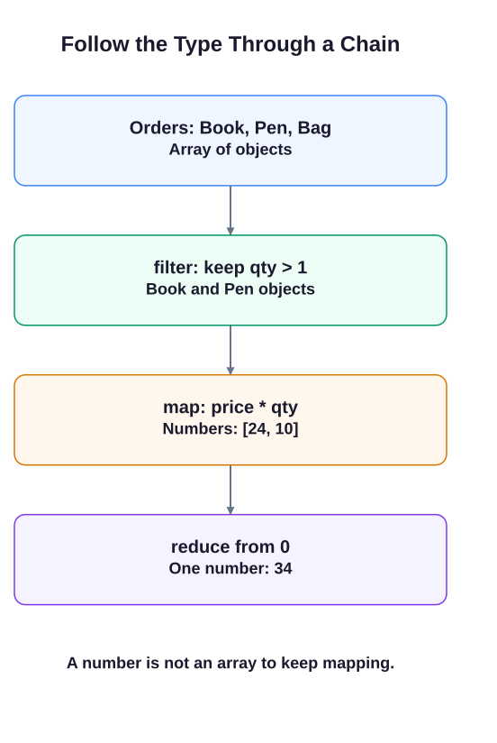

# map, filter, and reduce

The reporting desk needs names, an average salary, and a readable employee report. Each array method calls your callback once for each item it visits.

`filter` passes an item to its callback and keeps that item when the callback returns a truthy value. `map` puts each callback return value into a new array. Neither method changes the original array by itself. `reduce` passes the running result first and the current item second; the callback must return the running result for the next call. The final `0` supplies its starting value.

Read a chain from top to bottom. In the orders example, `filter` returns two order objects. `map` turns those objects into `[24, 10]`. `reduce` receives numbers, not order objects, and returns 34. Once the chain returns a number, array methods no longer apply to that result.

For an average, first keep the matching records, sum their salaries, then divide by their count. The supplied employee data always contains engineers. `Math.round` rounds the resulting average. Use `toLocaleString("en-US")` for the comma-separated salary display required here; choosing a locale avoids machine-dependent formatting.




## Combining all three

```javascript run
const orders = [
    { product: "Book", price: 12, qty: 2 },
    { product: "Pen",  price: 1,  qty: 10 },
    { product: "Bag",  price: 35, qty: 1 }
];

const total = orders
    .filter(o => o.qty > 1)                   // keep multiple-quantity orders
    .map(o => o.price * o.qty)                // calculate line total
    .reduce((sum, lineTotal) => sum + lineTotal, 0); // sum up

console.log(total);
```

Edit `script.js`, then use **Run** to inspect the supplied checkpoints. Use **Submit** to check your tasks in order. Keep the supplied probes; change only the requested definitions and final logs.

## Your Tasks

1. Set `engineers` to the employees whose `dept` is `"Engineering"`, using `filter`.
2. Use `map` on `engineers` to set `engineeringNames` to their names.
3. Set `avgEngineerSalary` to their salary sum divided by their count, rounded with `Math.round`; use `reduce` with an initial 0.
4. Use `map` to build `salaryReport` for every employee as `Name: $salary`, formatting salaries with `toLocaleString("en-US")`.
5. Log `Engineers: Alice,Carol,Eve | Avg salary: $107,667` using your computed names and average.
