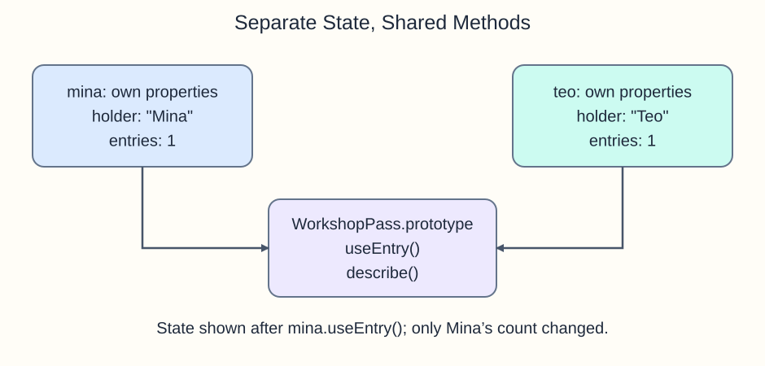

A class describes how to create objects with the same methods but separate state. `new WorkshopPass("Mina", 2)` creates an instance and calls its `constructor` with those two arguments. Inside the constructor, `this` is that new instance.

Assignments such as `this.entries = entries` create an own property on each instance. The `useEntry` and `describe` methods live on `WorkshopPass.prototype`, which instances share. When JavaScript cannot find a property on an instance, it looks along its prototype chain. Sharing a method does not mean sharing Mina's entry count with Teo.

Follow `mina.useEntry()`: the shared method runs with Mina as `this`, so only Mina's own `entries` changes.

```javascript run
class WorkshopPass {
  constructor(holder, entries) {
    this.holder = holder;
    this.entries = entries;
  }
  useEntry() { if (this.entries > 0) this.entries -= 1; }
  describe() { return `${this.holder}: ${this.entries} entries`; }
}
const mina = new WorkshopPass("Mina", 2);
const teo = new WorkshopPass("Teo", 1);
mina.useEntry();
console.log(mina.describe());
console.log(teo.describe());
```




## What to notice

In `script.js`, finish a smaller version of this pass before building a bank account in the next lesson. Keep each pass's `entries` on its own instance.

## Your Tasks

1. In the constructor, store `holder` and `entries` on `this`. The initial descriptions should log `Mina: 2 entries` and `Teo: 1 entries`.
2. In `useEntry()`, subtract one entry only when the current pass has any left. After two calls on Mina, log `Mina: 0 entries` and `Teo: 1 entries`; a third call must leave Mina at zero.
3. Confirm both passes share the prototype method by logging `shared method: true`.
