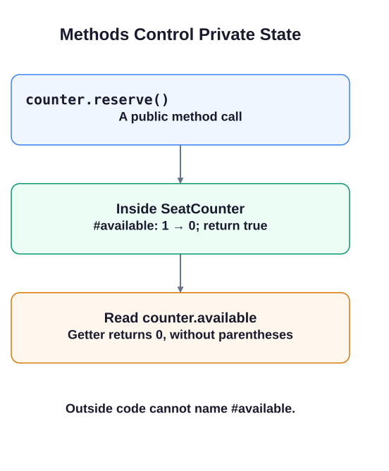

# A private seat counter

A seat counter needs to reject reservations after its seats run out. Keeping `#available` private prevents outside code from bypassing that rule with a direct assignment.

Declare a private field in the class body before using it. Each instance gets its own field. Methods in that declaring class read it as `this.#available`. The public getter `get available()` runs when you read `counter.available`, without parentheses. It returns a value without exposing a way to assign the private field.

The reservation method returns `false` before changing state when the count is zero. Otherwise it subtracts one and returns `true`. This example assumes a nonnegative integer starting count.

```javascript run
class SeatCounter {
  #available;
  constructor(seats) { this.#available = seats; }
  reserve() {
    if (this.#available === 0) return false;
    this.#available -= 1;
    return true;
  }
  get available() { return this.#available; }
}
const counter = new SeatCounter(1);
console.log(counter.reserve());
console.log(counter.reserve());
console.log(counter.available);
```




## What to notice

With two starting seats, both reservations would succeed and the final count would still be zero. Writing `counter.#available` outside the class would be a syntax error; do not put it in runnable code. Next, build a **stack** with a private array.
