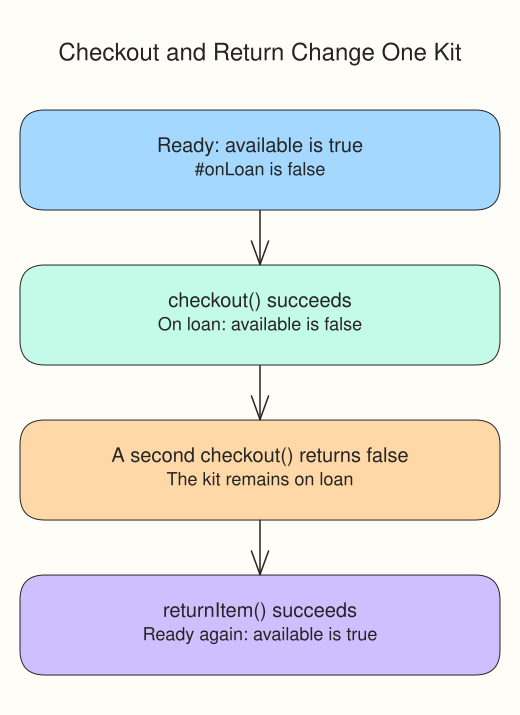

# Equipment desk checkout

An equipment desk loans camera kits. The base `Equipment` class owns private loan state and the methods that change it. `CameraKit` adds a lens and a more specific description.

The child cannot read `#onLoan` directly: that name belongs to its declaring class. It can call inherited public methods and read the public `available` getter. Calling `kit.checkout()` therefore runs parent-defined behavior on the camera kit's own state.

Inheritance fits this “a camera kit is equipment” relationship. Composition is different: an equipment desk could have an array of kits without extending `Equipment`. Use a property to hold the other objects when one object has or uses them, rather than treating it as their subtype.

```javascript run
class Equipment {
  #onLoan = false;
  constructor(label) { this.label = label; }
  checkout() {
    if (this.#onLoan) return false;
    this.#onLoan = true;
    return true;
  }
  returnItem() {
    if (!this.#onLoan) return false;
    this.#onLoan = false;
    return true;
  }
  get available() { return !this.#onLoan; }
  describe() { return `${this.label}: ${this.available ? "ready" : "on loan"}`; }
}
class CameraKit extends Equipment {
  constructor(label, lens) {
    super(label);
    this.lens = lens;
  }
  describe() { return `${super.describe()} (${this.lens} lens)`; }
}
const kit = new CameraKit("Travel camera", "wide");
console.log(kit.checkout());
console.log(kit.checkout());
console.log(kit.describe());
kit.returnItem();
console.log(kit.describe());
```




## What to notice

Without the return call, the last description would still say `on loan`. Next, build a different **library book** checkout model yourself.
