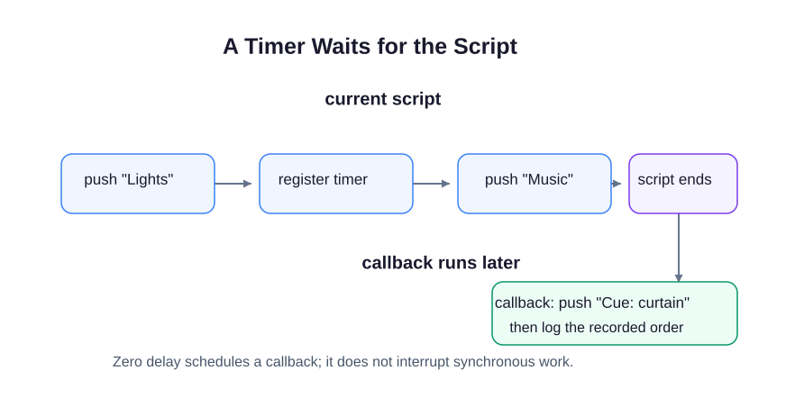

You already know how to pass a function as a callback. Here the browser calls that function later. The stage crew can announce the lights and music now, then run the curtain cue when a timer is ready.

Open `script.js` and press **Run**. Read the Console beside the preview: `Lights | Music | Cue: curtain`. The preview itself stays blank; this whole section uses JavaScript only and makes no network requests.

`setTimeout` is a browser-provided timer API, not a core language statement. Other JavaScript environments can provide timers too. `setTimeout(callback, 0)` registers a callback and returns immediately. Zero means no requested delay, not "run this before the next line." The current script finishes before the timer callback can run. A busy browser may run the callback later than the requested delay.

The array records what really happened. Change `Music` to `Applause`, run again, and check that the curtain cue is still last. Restore it before the exercise. There is no Submit task in this demo.
