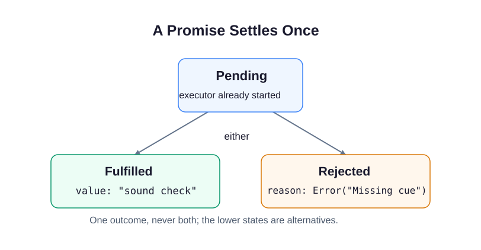
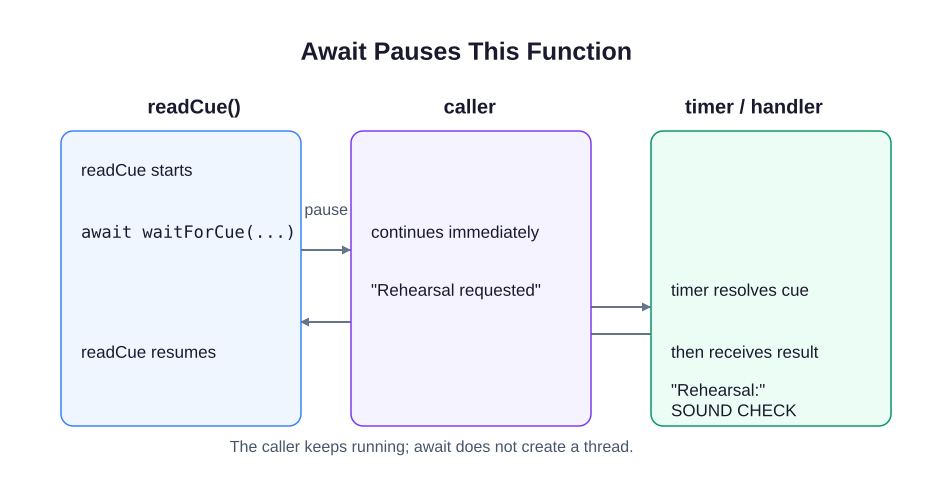

A rehearsal cue is not ready when the script starts. A Promise lets the caller describe what to do with the cue when it arrives.

A Promise begins **pending**. It settles once: **fulfilled** with a value, or **rejected** with a reason. In `waitForCue`, `new Promise` immediately runs the function that registers the timer. Later, the timer calls `resolve(cue)` or `reject(new Error(...))`. Settling a Promise does not run its `.then()` callback in the middle of the current line of code.

Run `script.js`. The Console prints `Rehearsal requested` first, then `Rehearsal: SOUND CHECK`. An `async` function always returns a Promise. `await` pauses that function until the cue settles; the calling script continues. It does not create a new JavaScript thread or make slow synchronous calculations stop blocking.

The `.then()` handler receives the returned uppercase text. `.catch()` handles a rejection, including an error thrown in an earlier handler. Returning an ordinary value from a handler fulfills the next Promise with that value; throwing rejects it. When a handler starts another asynchronous operation, return its Promise so the chain waits for it.

Change `sound check` to `doors open` and run again. Then try an empty string: the offline fixture rejects and the Console shows `Rehearsal failed: Missing cue`. Restore the original cue. The next exercise gives you separate helpers for waiting, transforming a result, and rejecting invalid input.
