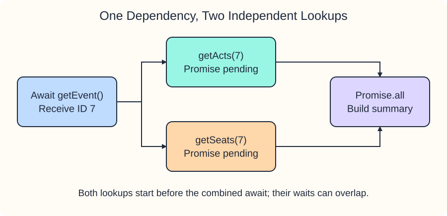

# Coordinate offline lookups

A rehearsal schedule needs an event ID before it can look up acts and seats. These are offline fixture functions: they return Promises containing local data, not HTTP responses. No request leaves the preview.

Run `script.js` and look for `Rehearsal | acts: 2 | seats: 4` in the Console. First, `await getEvent()` supplies the ID. Then the calls inside the array start both independent lookups before either is awaited. `Promise.all` combines their Promises; it does not start functions for you.

`const [acts, seats] = ...` unpacks the result array in input order, even if seats finish first. Concurrent means the waiting periods can overlap. It does not mean JavaScript executes both function bodies on separate threads.

If either lookup rejects, `await Promise.all(...)` throws and the `catch` returns the fallback summary. The other lookup is not automatically cancelled. Use this pattern when the result needs both pieces; a later demo keeps individual successes instead.

Change the ID returned by `getEvent` from `7` to `8` and run: the counts become zero. To inspect failure, temporarily replace `getActs`'s return with `throw new Error("Acts offline")`; Run shows `Unavailable | acts: 0 | seats: 0`. Restore both edits before the dashboard exercise.
