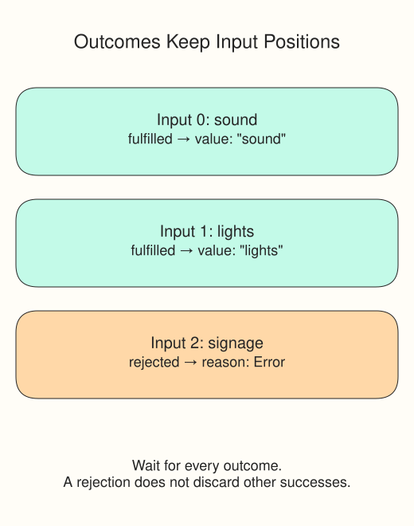

# Demo: Keep partial results

A rehearsal bulletin checks three offline dispatch desks. Sound and lights can still appear in the bulletin when signage fails. Using `Promise.all` would reject the combined result; `Promise.allSettled` waits for every input and fulfills with an array of outcome objects instead.

Run `script.js`: the Console prints `Ready: sound, lights | missed: 1`. The code attaches `allSettled` immediately to the array, so the rejected signage Promise has a handler. It does not leave a stray unhandled rejection.

`Promise.resolve(value)` is a quick way to make a fulfilled Promise; `Promise.reject(reason)` makes a rejected one. These fixtures are already settled, but the code after `await` still resumes asynchronously. The next exercise uses timers so its providers can remain pending.

Each fulfilled outcome has `status: "fulfilled"` and a `value`. Each rejected outcome has `status: "rejected"` and a `reason`. Check the status before reading the corresponding field. The outcome array preserves input order, not completion order.

Follow the `filter` and `map`: they select successful outcomes, then take their values. This demo counts missed desks; the exercise will record failed provider names using the same indexes as the input array.

Change `Promise.reject(new Error("signage offline"))` to `Promise.resolve("signage")`, Run, and check that the bulletin includes signage with `missed: 0`. Restore the rejected fixture before moving on. These are local Promises, not live services.
