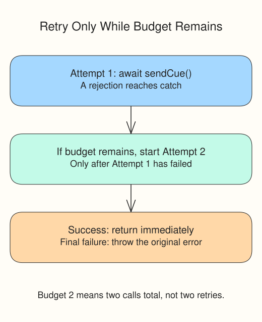

A rehearsal courier fails on its first handoff and accepts the second. `makeCueCourier()` returns a fresh offline function with its own attempt counter; it sends no request.

Run `script.js`. The Console shows `Delivered: rehearsal cue | attempts: 2`. The limit `2` means two attempts in total: the first call plus at most one retry.

Inside the loop, `return await sendCue()` does two jobs. Success returns immediately and ends the loop. Rejection throws inside this `try`, where `catch` can decide whether to retry. Writing only `return sendCue()` would hand the Promise to the caller before its later rejection could be caught here.

The next attempt starts only after the previous one rejects. No calls overlap. On the last failure, `throw error` preserves the original error instead of hiding it behind an empty result.

Change the last call's limit from `2` to `1`. Run and read `Delivery failed: Temporary courier outage`, then restore `2`. Our local fixture is safe to repeat. Real services may need delays and a way to prevent duplicate submissions; a rejected response alone does not prove that the server did no work.
